# Workin

Aplikasi latihan di rumah tanpa alat, berbasis riset, dengan pencatat kalori,
durasi, progres mingguan, dan berat badan. Dibuat dengan Flutter untuk Android.
Semua data tersimpan di HP: tanpa akun, tanpa server.

<p>
  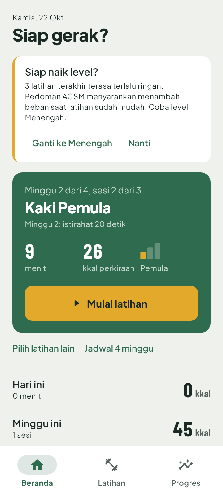
  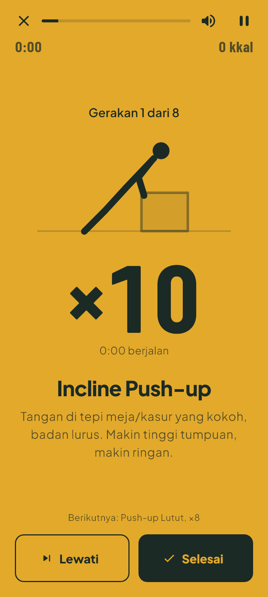
  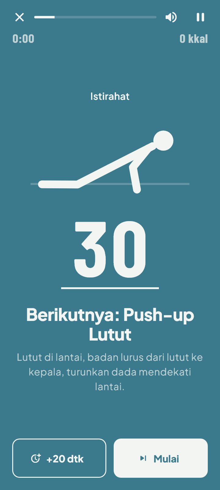
  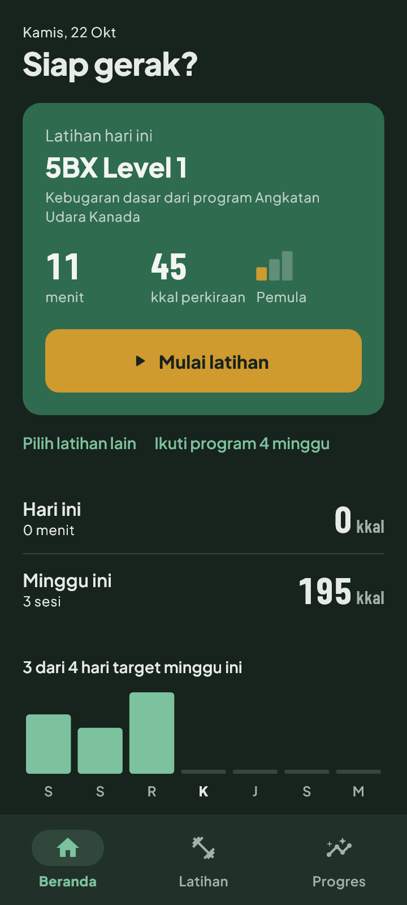
</p>

## Fitur

- **19 program berbasis riset.** Terdiri dari 4 protokol seluruh tubuh
  (7-Minute Workout, McMaster 11 menit, RCAF 5BX) dan 15 program kekuatan
  untuk dada, perut, kaki, tubuh atas, dan tubuh bawah, masing-masing di level
  pemula, menengah, dan lanjutan. Takarannya mengikuti pedoman ACSM, dan
  setiap program mencantumkan rujukannya.
- **Pemutar latihan yang terbaca dari jauh.** Tiap fase punya warna layar
  penuh: kunyit untuk bergerak, biru untuk istirahat, hijau untuk pemanasan
  dan pendinginan. Angkanya besar, ada figur animasi untuk ke-49 gerakan,
  dan layar tetap menyala selama latihan.
- **Panduan suara bahasa Indonesia.** Menyebut nama gerakan dan targetnya,
  memberi tahu "setengah jalan", dan menghitung mundur "tiga, dua, satu".
- **Program bertahap 4 minggu.** Bagian tubuh yang dilatih bergantian, dan
  takarannya naik setiap minggu (overload progresif).
- **Saran naik atau turun level** dari penilaian "terlalu ringan / pas /
  terlalu berat" setelah latihan.
- **Latihanku.** Susun latihan sendiri: pilih gerakan, lalu atur repetisi
  atau durasi, putaran, dan istirahat.
- **Tracker** kalori (MET dari 2024 Compendium of Physical Activities),
  durasi, target hari per minggu, riwayat sesi, dan grafik berat badan.
- **Pengingat latihan** di hari dan jam pilihanmu.
- **Mode terang dan gelap.**

## Tangkapan layar

| Daftar latihan | Detail program | Program 4 minggu | Latihan buatan |
|---|---|---|---|
| 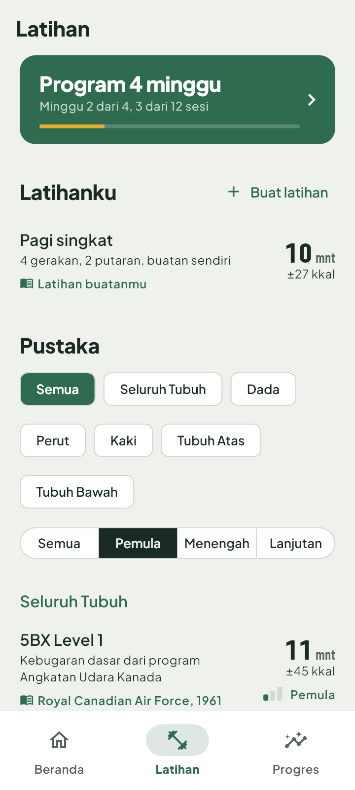 | 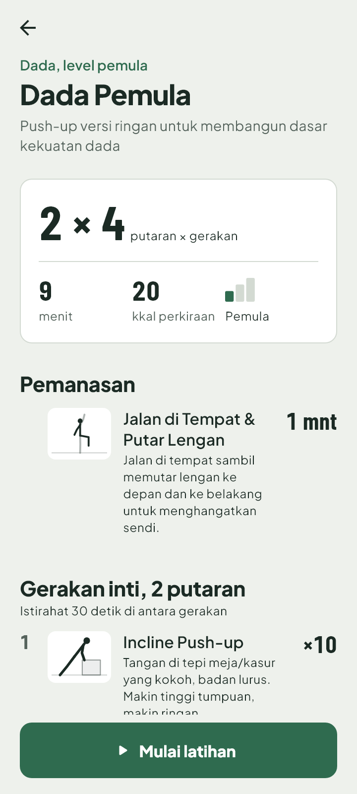 | 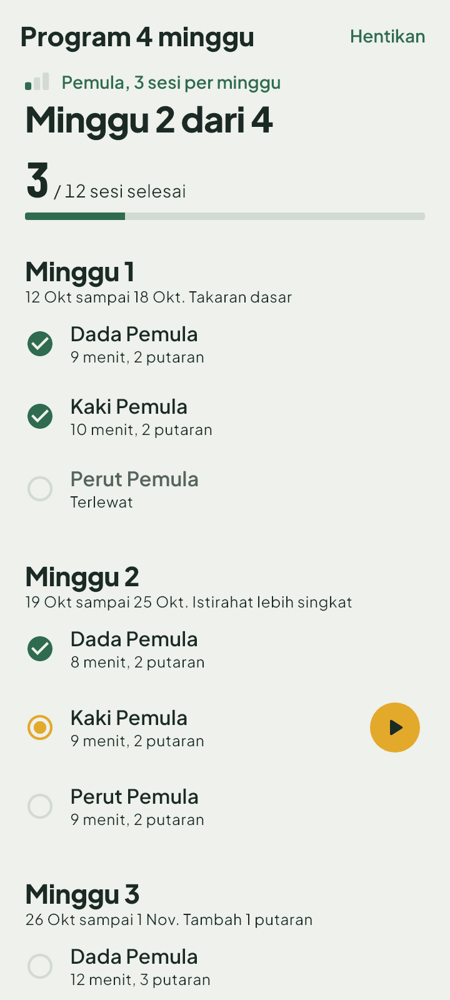 | 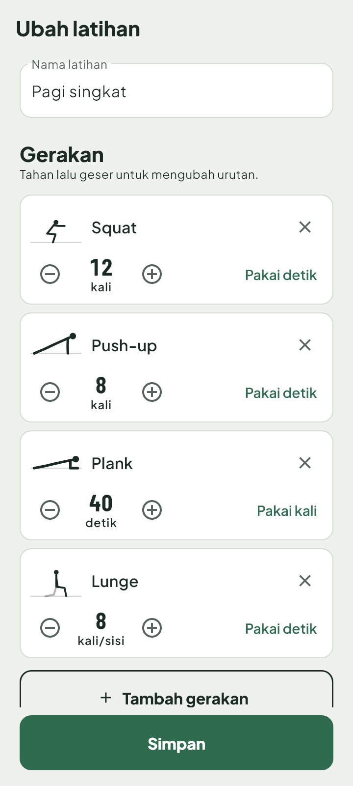 |

| Ringkasan latihan | Progres & berat badan | Pengaturan |
|---|---|---|
| 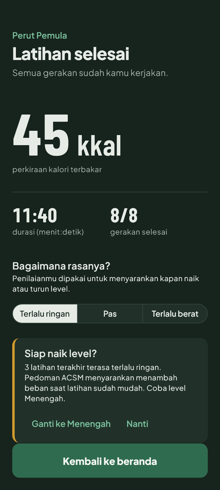 | 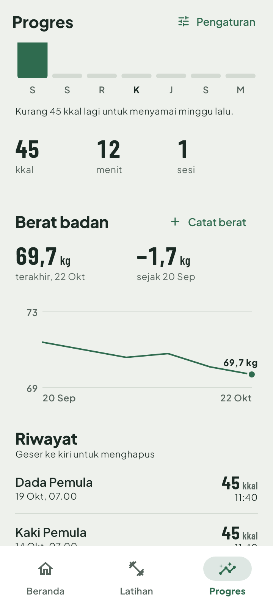 | 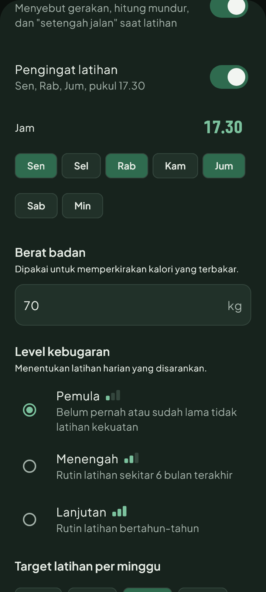 |

## Menjalankan

Butuh Flutter 3.29 (Dart 3.7) dan Android SDK.

```bash
flutter pub get
flutter test             # 50 tes logika & tampilan
flutter run              # HP Android terhubung via USB
flutter build apk        # APK di build/app/outputs/flutter-apk/
```

> Versi `wakelock_plus`, `flutter_tts`, dan `flutter_local_notifications`
> sengaja dikunci agar cocok dengan Kotlin 1.8 dan AGP 8.7 di proyek ini.
> Lihat [docs/RANCANGAN.md](docs/RANCANGAN.md).

## Struktur

```
lib/
  data/       pustaka gerakan & program berbasis riset, pose figur
  models/     gerakan, program, sesi, rencana 4 minggu, latihan buatan, berat
  services/   timer latihan, kalori, statistik, suara, saran level, rencana, pengingat
  state/      AppState (penyimpanan lokal & pengaturan)
  screens/    halaman
  widgets/    komponen (figur gerakan, grafik, dll.)
docs/
  RANCANGAN.md   rancangan & keputusan teknis
  PROGRES.md     progres pengerjaan & backlog
```

## Rujukan utama

- American College of Sports Medicine. Progression models in resistance
  training for healthy adults. *Med Sci Sports Exerc.* 2009;41(3):687–708.
- Klika B, Jordan C. High-intensity circuit training using body weight.
  *ACSM's Health & Fitness Journal.* 2013;17(3):8–13.
- Archila LR, et al. Simple bodyweight training improves cardiorespiratory
  fitness with minimal time commitment. *Int J Exerc Sci.* 2021;14(3):93–100.
- Herrmann SD, et al. 2024 Adult Compendium of Physical Activities.
  *J Sport Health Sci.* 2024;13(1):6–12.

Estimasi kalori bersifat perkiraan. Konsultasikan dengan dokter jika kamu punya
kondisi jantung, sendi, atau baru pulih dari cedera.

## Lisensi font

Plus Jakarta Sans dan Barlow Condensed memakai SIL Open Font License 1.1
(`assets/fonts/OFL-*.txt`).
